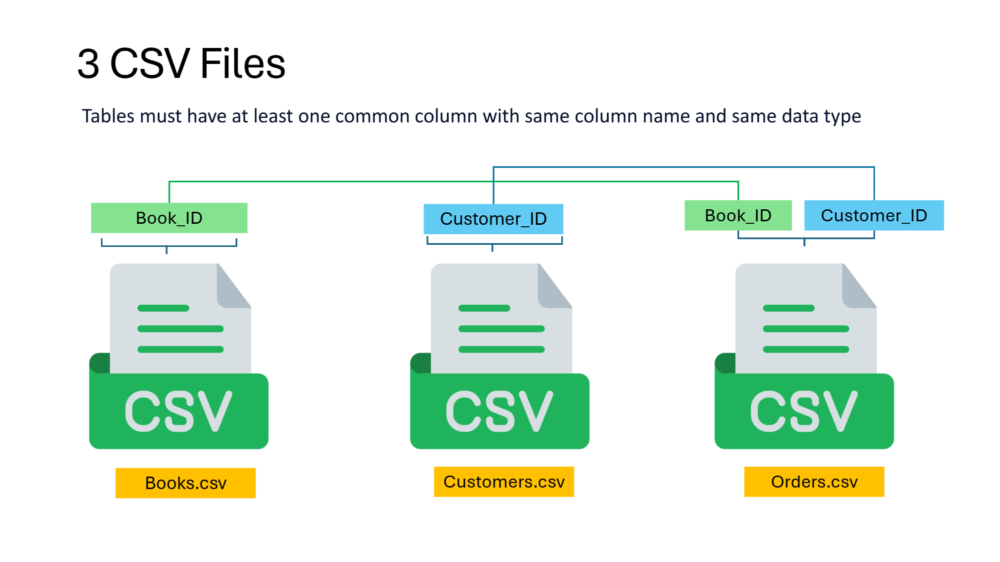

<div align="center">


# 📚 Online Book Store Analysis: End-to-End SQL Project

**Turning raw book, customer and order data into business insights using SQL**


</div>

---

## 📖 Table of Contents

1. [Project Overview](#-project-overview)
2. [Objectives](#-objectives)
3. [Dataset Description](#-dataset-description)
4. [Database Schema](#-database-schema)
5. [Project Structure](#-project-structure)
6. [Getting Started](#-getting-started)
7. [Business Questions and SQL Solutions](#-business-questions-and-sql-solutions)
8. [Key Insights](#-key-insights)
9. [SQL Concepts Used](#-sql-concepts-used)
10. [Conclusion](#-conclusion)
11. [Author](#-author)

---

## 📌 Project Overview

This project is an end-to-end SQL analysis of an **online book store**. It covers the full workflow: creating the database schema, importing the data from CSV files, and answering real business questions with SQL queries.

The analysis looks at inventory, customer demographics, sales performance and genre popularity, the kind of questions a book store's management team would ask every day.

---

## 🎯 Objectives

- Design a relational database with proper **primary keys, foreign keys and constraints**
- Import raw data from **three CSV files** into SQL tables
- Retrieve, filter and aggregate data to answer business questions
- Identify **best-selling genres**, **high-value orders**, **low-stock books** and **customer segments**
- Practise core and intermediate SQL: filtering, joins, aggregation, subqueries and date functions

---

## 🗂 Dataset Description

The dataset has **3 CSV files**, each with **500 rows**. The tables are linked through common columns that share the same name and data type.



### 1. `Books.csv`

| Column | Type | Description |
|---|---|---|
| Book_ID | Integer | Unique ID for each book (Primary Key) |
| Title | String | Title of the book |
| Author | String | Author of the book |
| Genre | String | Genre / category of the book |
| Published_Year | Integer | Year the book was published |
| Price | Float | Price of the book |
| Stock | Integer | Number of copies in stock |

### 2. `Customers.csv`

| Column | Type | Description |
|---|---|---|
| Customer_ID | Integer | Unique ID for each customer (Primary Key) |
| Name | String | Customer name |
| Email | String | Customer email (unique) |
| Phone | Integer | Contact number |
| City | String | City of the customer |
| Country | String | Country of the customer |

### 3. `Orders.csv`

| Column | Type | Description |
|---|---|---|
| Order_ID | Integer | Unique ID for each order (Primary Key) |
| Customer_ID | Integer | Customer who placed the order (Foreign Key) |
| Book_ID | Integer | Book that was ordered (Foreign Key) |
| Order_Date | Date | Date the order was placed |
| Quantity | Integer | Number of copies ordered |
| Total_Amount | Float | Total value of the order |

---

## 🏗 Database Schema

```sql
CREATE TABLE books (
    book_id         INT PRIMARY KEY,
    title           VARCHAR(100) NOT NULL,
    author          VARCHAR(100) NOT NULL,
    genre           VARCHAR(50),
    published_year  INT,
    price           NUMERIC(8,2) CHECK (price >= 0),
    stock           INT CHECK (stock >= 0)
);

CREATE TABLE customers (
    customer_id  INT PRIMARY KEY,
    name         VARCHAR(100) NOT NULL,
    email        VARCHAR(150) UNIQUE,
    phone        VARCHAR(20),
    city         VARCHAR(100),
    country      VARCHAR(100)
);

CREATE TABLE orders (
    order_id      INT PRIMARY KEY,
    customer_id   INT NOT NULL REFERENCES customers(customer_id),
    book_id       INT NOT NULL REFERENCES books(book_id),
    order_date    DATE NOT NULL,
    quantity      INT CHECK (quantity > 0),
    total_amount  NUMERIC(10,2)
);
```

### Entity Relationship

```
customers (1) ────< orders >──── (1) books
 customer_id          customer_id     book_id
                      book_id
```

- One **customer** can place many **orders**
- One **book** can appear in many **orders**
- `orders` is the link table between `customers` and `books`

---

## 📁 Project Structure

```
Online-Book-Store-SQL-Project/
│
├── data/
│   ├── Books.csv
│   ├── Customers.csv
│   └── Orders.csv
│
├── images/
│   ├── cover.png
│   └── csv_files.png
│
├── Online_Book_Store_Analysis_Queries.sql
└── README.md
```

---

## 🚀 Getting Started

1. **Clone the repository**
   ```bash
   git clone https://github.com/<your-username>/Online-Book-Store-SQL-Project.git
   ```
2. **Create a database** in PostgreSQL (or your preferred SQL engine).
3. **Run the schema script** from `Online_Book_Store_Analysis_Queries.sql` to create the three tables.
4. **Import the CSV files** in this order, so foreign keys are satisfied:
   `Books.csv` → `Customers.csv` → `Orders.csv`
5. **Run the analysis queries** one by one and explore the results.

---

## 🔍 Business Questions and SQL Solutions

### Q1. Retrieve all books in the "Fiction" genre
```sql
SELECT title AS Books, genre AS Genre
FROM books
WHERE genre = 'Fiction';
```

### Q2. Find books published after the year 1950
```sql
SELECT book_id, title AS Books
FROM books
WHERE published_year > 1950;
```

### Q3. List all customers from Canada
```sql
SELECT name, email, phone
FROM customers
WHERE country = 'Canada';
```

### Q4. Show the number of orders placed in November 2023
```sql
-- Method 1: EXTRACT
SELECT COUNT(order_id) AS Total_Orders
FROM orders
WHERE EXTRACT(MONTH FROM order_date) = 11
  AND EXTRACT(YEAR FROM order_date) = 2023;

-- Method 2: Date range (index-friendly)
SELECT COUNT(order_id) AS Total_Orders
FROM orders
WHERE order_date >= '2023-11-01'
  AND order_date <  '2023-12-01';
```

### Q5. Retrieve the total stock of books available
```sql
SELECT SUM(stock) AS Total_Stock
FROM books;
```

### Q6. Find the details of the most expensive book
```sql
SELECT book_id, author, title, price AS Expensive_Book
FROM books
ORDER BY price DESC
LIMIT 1;
```

### Q7. Show all customers who ordered more than 1 copy of a book
```sql
-- Simple version
SELECT customer_id, order_id, quantity
FROM orders
WHERE quantity > 1;

-- Using JOIN to include customer details
SELECT c.customer_id, c.name, c.email, o.order_id, o.quantity
FROM customers c
JOIN orders o ON c.customer_id = o.customer_id
WHERE o.quantity > 1
ORDER BY o.quantity DESC;
```

### Q8. Retrieve all orders where the total amount exceeds $20
```sql
SELECT *
FROM orders
WHERE total_amount > 20;
```

### Q9. Genre analysis

**List all genres available in the store**
```sql
SELECT DISTINCT genre AS "Genres"
FROM books;
```

**Count the number of books in each genre**
```sql
SELECT COUNT(book_id) AS "Total_Books", genre AS "Genres"
FROM books
GROUP BY genre
ORDER BY COUNT(book_id) ASC;
```

**Find the most purchased genres (copies sold and revenue)**
```sql
SELECT SUM(o.quantity)     AS "Total_Books_Sold",
       SUM(o.total_amount) AS "Total_Amount",
       b.genre
FROM orders o
JOIN books b ON o.book_id = b.book_id
GROUP BY b.genre
ORDER BY SUM(o.total_amount) DESC;
```

### Q10. Find the books with the lowest stock
```sql
SELECT book_id, title, stock
FROM books
WHERE stock = (SELECT MIN(stock) FROM books);
```

---

## 💡 Key Insights

The queries in this project help the business to:

- **Manage inventory**: spot low-stock books that need restocking (Q5, Q10)
- **Understand the catalogue**: see how many books exist per genre and which genres are available (Q1, Q9)
- **Identify top genres**: rank genres by copies sold and revenue to guide purchasing decisions (Q9)
- **Segment customers**: find customers by country and bulk buyers who order multiple copies (Q3, Q7)
- **Track sales**: monitor monthly order volume and high-value orders (Q4, Q8)
- **Review pricing**: find the most expensive title in the catalogue (Q6)

> 📝 *Add your own findings here after running the queries, for example "Genre X generated the highest revenue" or "N books are at minimum stock".*

---

## 🛠 SQL Concepts Used

| Category | Concepts |
|---|---|
| **DDL** | `CREATE TABLE`, primary keys, foreign keys, `CHECK`, `UNIQUE`, `NOT NULL` |
| **Filtering** | `WHERE`, comparison and logical operators |
| **Aggregation** | `COUNT`, `SUM`, `MIN`, `GROUP BY` |
| **Sorting and limiting** | `ORDER BY`, `LIMIT` |
| **Joins** | `INNER JOIN` across tables |
| **Subqueries** | Scalar subquery with `MIN()` |
| **Date functions** | `EXTRACT`, date range filtering |
| **Other** | `DISTINCT`, aliases |

---

## ✅ Conclusion

This project shows how SQL can turn raw transactional data into useful business insights. It covers database design, data import and a range of analytical queries, and it can be extended with window functions, CTEs, customer lifetime value and monthly sales trends.

---

## 👤 Author

**Pinjari Mohammed Ashraf**
📧 pinjarimohammedashraf@gmail.com

⭐ If you found this project helpful, please give it a star!
